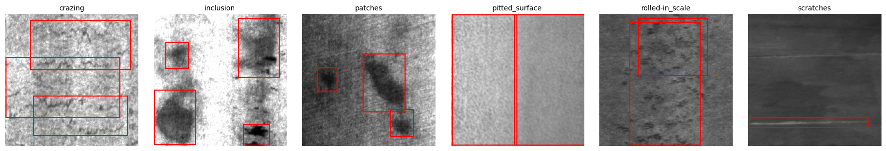
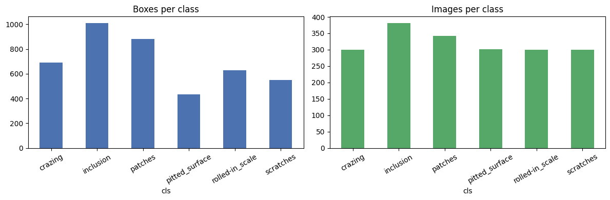

# Steel Surface Defect Detection — NEU-DET

A YOLOv8 detector for defects on hot-rolled steel, wired into a small pipeline that turns
detections into a maintenance report (optionally written by a vision-language model) and a
Streamlit demo. Built over 8 weeks for Summer of Science 2026 at IIT Bombay.

## What it is

Steel surface inspection is a good test of object detection: the images are small (200×200
grayscale), the defects are often faint, and some classes look like texture rather than objects.
The project goes **image → YOLOv8 → report**:

1. A YOLOv8 model detects and localizes 6 defect types — crazing, inclusion, patches, pitted
   surface, rolled-in scale, scratches.
2. Each detection gets a rough severity (`CLASS_SEVERITY` in `app/pipeline.py`).
3. A report is generated. If `OPENAI_API_KEY` is set, a VLM (`gpt-4o-mini`) gets the raw image
   *and* the detections together; otherwise a structured template report is built, so the
   pipeline always runs without a key.

The midterm write-up is in [`REPORT.md`](REPORT.md); the Week-6 theory notes on contrastive
learning, CLIP and BLIP are in [`notes/contrastive_learning.md`](notes/contrastive_learning.md).

## What I did

**Data + EDA** (`notebooks/eda.ipynb`). NEU-DET has 1,800 images, ~300 per class, with 4,189
boxes in Pascal VOC XML (2.33 boxes/image on average, max 9). It's balanced by image but not by
box: inclusion (1,011) and patches (881) have the most boxes, pitted surface the fewest (432).
Texture-like defects (crazing, rolled-in scale) often span much of the frame; inclusions and pits
are small; scratches are elongated.


*One NEU-DET image per defect class with its ground-truth (annotated) boxes, from `notebooks/eda.ipynb`.*


*Boxes per class vs images per class: balanced by image, not by box (EDA notebook output).*

**Conversion.** `scripts/voc_to_yolo.py` recursively converts VOC XML to normalized YOLO txt,
makes a stratified 85/15 split (1,529 train / 271 val images) and writes `data.yaml`.

**Baseline** (`scripts/train.py`). YOLOv8n transfer-learned from pretrained weights — 1,529
images is too few to train from scratch — at imgsz 320, 50 epochs, batch 16, on a Colab T4.

**Tuning** (`scripts/tune.py`). Crazing was clearly the weakest class, so I targeted it: bigger
model (YOLOv8s), higher resolution (640, since crazing is faint hairline cracking), 100 epochs with
early stopping, and heavier augmentation (both flips — defects have no orientation — HSV/brightness
jitter, small rotations, mosaic/mixup/copy-paste).

**Pipeline + app.** `app/pipeline.py` (CLI), `app/streamlit_app.py` (upload an image, see the
overlay and report), `scripts/test_pipeline.py` (smoke test on 3 random val images), and a
`Dockerfile` for the Streamlit demo.

### Results (271-image validation set, from `results_metrics.json` / `results_tuned.json`)

| | Baseline (v8n, 320, 50 ep) | Tuned (v8s, 640, 100 ep) |
|---|---:|---:|
| mAP@0.5 | 0.763 | 0.769 |
| mAP@0.5:0.95 | 0.463 | 0.452 |
| Precision | 0.769 | 0.683 |
| Recall | 0.656 | 0.718 |
| **crazing** mAP@0.5 | **0.365** | **0.423** |
| inclusion | 0.855 | 0.802 |
| patches | 0.899 | 0.918 |
| pitted surface | 0.894 | 0.889 |
| rolled-in scale | 0.631 | 0.667 |
| scratches | 0.934 | 0.918 |

## What I learnt

- **Look at per-class numbers, not just mAP.** The headline 0.763 hid that crazing was at 0.365
  while everything else was 0.63–0.93. That one class set the whole tuning agenda.
- **Tuning is a trade, not a free win.** The tuned run lifted crazing (0.365 → 0.423) and recall,
  but overall mAP@0.5 barely moved (+0.006), mAP@0.5:0.95 and precision *dropped*, and inclusion got
  worse. I changed model size, resolution, epochs and augmentation all at once, so I can't say which
  lever did what — next time I'd change one thing per run.
- **Format plumbing is real work.** The first bottleneck wasn't the model, it was VOC XML vs. YOLO
  txt. Writing a robust converter that also did the split saved a lot of later pain.
- **Texture defects don't fit the "object" mental model.** Crazing and rolled-in scale cover big
  diffuse regions, so box-level IoU is harsh on them. That's partly why they score lowest.
- **Degrade gracefully.** Making the VLM optional (template fallback) meant the demo works for
  anyone, with or without an API key. Studying CLIP/BLIP also made it clear why the VLM should see
  the pixels directly rather than a text caption of the image.

## Repo structure

```
scripts/
  download_data.py     fetch NEU-DET via kagglehub
  voc_to_yolo.py       VOC XML -> YOLO txt + stratified split + data.yaml
  train.py             baseline YOLOv8 training + metrics -> results_metrics.json
  tune.py              tuning run -> results_tuned.json
  test_pipeline.py     end-to-end smoke test
app/
  pipeline.py          image -> YOLO -> report (VLM or template)
  streamlit_app.py     upload-an-image demo
notebooks/eda.ipynb    dataset EDA (with outputs)
notes/contrastive_learning.md   Week-6 study notes
REPORT.md              midterm progress report
Dockerfile             containerized Streamlit demo
```

`datasets/`, `runs/` and `*.pt` weights are git-ignored, so you need to train before running the app.

## How to run

```bash
pip install -r requirements.txt
pip install streamlit openai          # app + optional VLM report (not in requirements.txt yet)

python scripts/download_data.py                                   # needs Kaggle credentials
python scripts/voc_to_yolo.py --src <path-printed-above> --dst datasets/neu
python scripts/train.py --data datasets/neu/data.yaml --epochs 50  # baseline
python scripts/tune.py  --data datasets/neu/data.yaml --model yolov8s.pt --imgsz 640 --epochs 100

python app/pipeline.py --image path/to/steel.jpg     # defaults to the baseline weights path
streamlit run app/streamlit_app.py
python scripts/test_pipeline.py
```

Set `OPENAI_API_KEY` to get VLM-written reports; without it you get the template report.
A GPU (I used Colab) is strongly recommended for training.

## References

- Ultralytics YOLOv8 — https://docs.ultralytics.com/
- Song & Yan, "A noise robust method based on completed local binary patterns for hot-rolled
  steel strip surface defects," *Applied Surface Science*, 2013.
- Radford et al., "Learning Transferable Visual Models From Natural Language Supervision" (CLIP), 2021.
